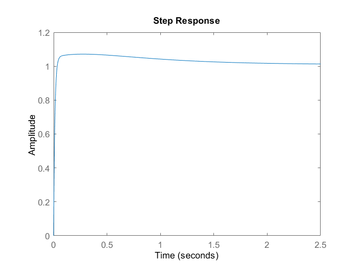
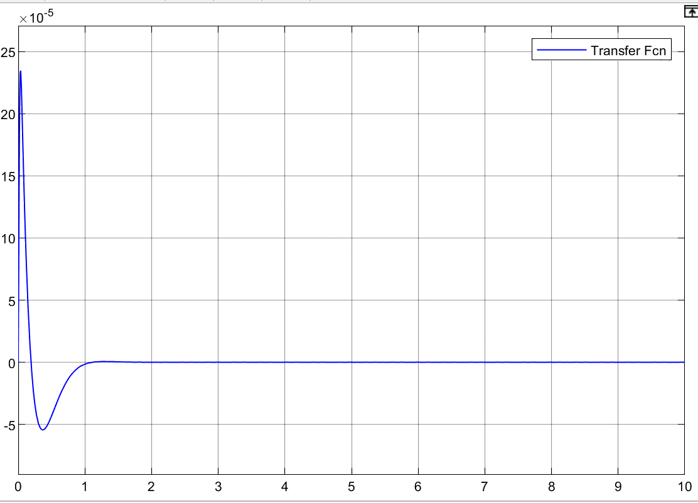

# Inverted Pendulum Control

MATLAB and Simulink study of an inverted pendulum mounted on a cart, covering mathematical modeling, stability analysis, PID control, full-state feedback, and comparisons with a nonlinear model.

The main work examines how feedback can stabilize the upright operating point and where a controller designed from a linear model can fail on nonlinear dynamics. The supplied report is in Persian; this README and the accompanying guides provide an English overview.

## Project contents

| Area | Included work |
| --- | --- |
| Modeling | Physical parameters, state-space representation, cart-position and pendulum-angle transfer functions |
| Open-loop analysis | Pole locations, root locus, step response, Bode and Nyquist plots, gain/phase margins |
| Model reduction | Comparison between the original and reduced-order angle models |
| PID control | MATLAB response analysis, a Simulink implementation, and saved figures |
| State feedback | Ackermann pole placement, alternative pole choices, and Simulink comparisons |
| Nonlinear comparison | Saved step and impulse-train experiments showing limits of the linear controller |
| Reference material | Credited third-party LQR/swing-up examples, a legacy GUI, and supplied animation media |

## Selected saved results

These figures are preserved from the submitted project. Different scripts, models, and report sections use different controller settings; they should not be interpreted as one reproducible experiment with a single gain set.

| PID response | State-feedback response |
| --- | --- |
|  |  |

The original nonlinear comparisons show that the tested linear PID configuration does not provide satisfactory nonlinear behavior. This is an observed limitation of the submitted design.

## Getting started

Requirements: MATLAB, Control System Toolbox, and Simulink for the `.slx` models. The optional 3D animation examples also use Simulink 3D Animation/legacy VR blocks. The original MATLAB release was not specified.

Clone the repository and open MATLAB in its root:

```bash
git clone https://github.com/Arian-Abdollahi/inverted-pendulum-control.git
cd inverted-pendulum-control
```

Start with the modeling scripts, then inspect the PID and state-feedback examples independently:

```matlab
run('analysis/modeling/state.m');
eigenvalues
run('analysis/modeling/transfer_function.m');

clearvars;
run('controllers/pid/final_pid.m');

clearvars;
run('controllers/state_feedback/state_feedback.m');

open_system('controllers/pid/PID.slx');
```

See [running instructions](docs/RUNNING.md) for all entry points, dependencies, and known script limitations. Run each example in its own workspace and avoid adding every subfolder to the MATLAB path.

## Documentation and report

- [Physical model and equations](docs/MODEL.md)
- [How to run the scripts and models](docs/RUNNING.md)
- [Interpretation of the saved results](docs/RESULTS.md)
- [Verification scope](docs/VERIFICATION.md)
- [Technical report — PDF, Persian](reports/project_report.pdf)
- [Video and animation references](media/README.md)
- [Team and third-party credits](CREDITS.md)
- [Source-file mapping and exclusions](docs/SOURCE_MANIFEST.json)

## Verification status

The physical model, transfer-function coefficients, controllability/observability ranks, and state-feedback pole placement were independently checked using NumPy/SciPy. All seven Simulink archives passed ZIP/XML integrity checks. MATLAB and Simulink simulations were **not rerun** during repository preparation; saved figures and reported performance remain original project evidence.

## Authorship and reuse

The source report credits Arian Abdollahi, Matin Masoudi, Armin Hatami, and Mohammad Sadegh Rezvani. Individual contributions are not specified in the supplied files. Third-party animation code is separated under `third_party/`; its original notices and the supplied MIT license are retained. No new project-wide license has been assigned. See [CREDITS.md](CREDITS.md).
